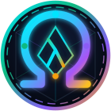
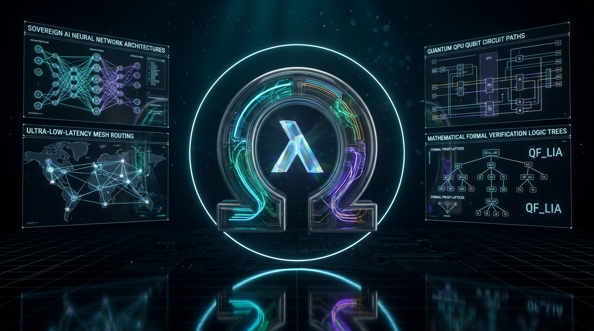

<h1>
  
  Ricardo Bueno (<code>@OmegaSoftDLL</code>)<br />
  <sub>Founder &amp; Principal Systems Architect · <b>Omega DeepTech Systems Inc. (ODSI)</b> · Creator of <b>Lume</b>, <b>LumeLabs</b>, <b>OmegaDesk</b> &amp; <b>Omega LLM</b></sub>
</h1>
<br clear="left"/>

<div align="center">

[-10b981?style=for-the-badge&logo=github)](https://github.com/OmegaSoftDLL/Lume)
[](https://github.com/OmegaSoftDLL/omegadesk)
[](https://github.com/OmegaSoftDLL/omega-sovereign)
[](https://github.com/OmegaSoftDLL/omega-llm)
[](https://github.com/OmegaSoftDLL/Lume/wiki/Universal-Chameleon-Polyglot-Engine)
[](https://github.com/OmegaSoftDLL/Lume/blob/main/LUMELABS.md)

<br />

<a href="https://github.com/OmegaSoftDLL">
  
</a>

<br />

<a href="https://github.com/OmegaSoftDLL/Lume">
  
</a>

</div>

---

## 🌌 OmegaSoftDLL Sovereign Ecosystem Portfolio · Portfólio Soberano ODSI

| Project & Emblem | Repository & Portal Links | Core Architecture & Tech Stack | Key Highlights & Verification |
| :--- | :--- | :--- | :--- |
| <br />**🦎 Lume (`v1.1.0`)** | [**`OmegaSoftDLL/Lume`**](https://github.com/OmegaSoftDLL/Lume)<br />[Website](https://omegasoftdll.github.io/lume/) · [Wiki (11p)](https://github.com/OmegaSoftDLL/Lume/wiki) · [Projects #5](https://github.com/users/OmegaSoftDLL/projects/5) · [LumeLabs](https://github.com/OmegaSoftDLL/Lume/blob/main/LUMELABS.md) | **100% Native Lume (`.src`)** · Zero-C `lumec` + `lasm` · Embedded `QF_LIA`/`QF_NIA` Prover · 4-Tier Memory Compactor · 27 Targets | `stage2 == stage3` fixpoint · `413` formal proofs · `85/85` Claude + Red-Team audit · 9-Ecosystem Chameleon FFI (`[I0003]`) · `31.8x` faster |
| <br />**🦅 OmegaDesk** | [**`OmegaSoftDLL/omegadesk`**](https://github.com/OmegaSoftDLL/omegadesk)<br />[Docs](https://github.com/OmegaSoftDLL/omegadesk/blob/main/docs/index.md) · [Wiki](https://github.com/OmegaSoftDLL/omegadesk/tree/main/docs/wiki) · [Roadmap](https://github.com/OmegaSoftDLL/omegadesk/blob/main/PROJECTS.md) | **Rust + Flutter + WebRTC** · Self-Hosted Zero-Trust Remote Desktop · `Ed25519` + `X25519` + `ChaCha20-Poly1305` · Relay/Rendezvous | End-to-end encrypted P2P/Relay remote support, multi-monitor low-latency streaming & enterprise session audit |
| <br />**⚡ Omega Sovereign** | [**`OmegaSoftDLL/omega-sovereign`**](https://github.com/OmegaSoftDLL/omega-sovereign)<br />[Docs](https://github.com/OmegaSoftDLL/omega-sovereign/blob/main/docs/index.md) · [Wiki](https://github.com/OmegaSoftDLL/omega-sovereign/tree/main/docs/wiki) · [Roadmap](https://github.com/OmegaSoftDLL/omega-sovereign/blob/main/PROJECTS.md) | **100% Native Lume** · Win64 PE32+ Native GUI (`OmegaSovereign_GUI.exe`) + Web Cockpit · Local Ollama (`Gemma 4 E2B` + `Ministral 3 3B`) | Multimodal local AI workstation, native Win64 GUI with embedded Lumi `RT_ICON`, zero-cloud privacy & formal contracts |
| <br />**🎨 lume.tmLanguage** | [**`OmegaSoftDLL/lume.tmLanguage`**](https://github.com/OmegaSoftDLL/lume.tmLanguage)<br />[Docs](https://github.com/OmegaSoftDLL/lume.tmLanguage/blob/main/docs/index.md) · [Wiki](https://github.com/OmegaSoftDLL/lume.tmLanguage/tree/main/docs/wiki) · [Roadmap](https://github.com/OmegaSoftDLL/lume.tmLanguage/blob/main/PROJECTS.md) | **TextMate Grammar + GitHub Linguist** · VS Code / Neovim / JetBrains Syntax Highlighting for `.lume` & `.src` | Full grammar coverage for `verify`, `req`/`ens`, `@bound`, `@secret`, algebraic effects, Perceus & Chameleon FFI |
| <br />**🧠 Omega LLM** | [**`OmegaSoftDLL/omega-llm`**](https://github.com/OmegaSoftDLL/omega-llm)<br />[Docs](https://github.com/OmegaSoftDLL/omega-llm/blob/main/docs/index.md) · [Wiki](https://github.com/OmegaSoftDLL/omega-llm/tree/main/docs/wiki) · [Roadmap](https://github.com/OmegaSoftDLL/omega-llm/blob/main/PROJECTS.md) | **vLLM v0.30 + LangGraph + GKE + Terraform** · OpenAI Billing Gateway (`omk_*`) · gVisor Sandbox · TRL SFT/DPO/Mergekit Fabrica | `127/127` K8s 1.33 manifests · `9/9` Helm Qdrant · `50/50` pytest suites · 4 GPU phases (`L4`, `A100`, `H100`, `H200`) |
| <br />**🛡️ GuildyUP** | [**`OmegaSoftDLL/guildyup`**](https://github.com/OmegaSoftDLL/guildyup)<br />[Spec v2.1](https://github.com/OmegaSoftDLL/guildyup/blob/main/GUILDYUP.md) · [Wiki](https://github.com/OmegaSoftDLL/guildyup/tree/main/docs/wiki) · [Roadmap](https://github.com/OmegaSoftDLL/guildyup/blob/main/PROJECTS.md) | **TypeScript + NestJS + Prisma + PostgreSQL + Socket.IO** · `Guildy Match` Engine · Auto UTC Slot Finder · Steam Trophy Proof | 24 modules (`M01`–`M24`), 31 business rules (`RN-01`–`RN-31`), blind anti-retaliation reputation & `55` E2E/domain tests |

---

## Flagship Creation: [Lume `v1.1.0` (2026 Edition)](https://github.com/OmegaSoftDLL/Lume)

> **EN:** **Lume** is a 100% self-hosted (`stage2 == stage3`), formally verified, zero-C systems, polyglot interoperability, autonomous AI, and post-quantum programming language. Every binary emitted by Lume has its arithmetic contracts (`QF_LIA` / `QF_NIA` / `QF_BV`), memory linearity (Perceus), worst-case hardware cycle bounds (`@bound(cycles)`), constant-time cryptographic side-channel freedom (`@secret`), and foreign-language boundary contracts (`[I0003]`) mathematically proven at compile time — with **zero external C compilers (`gcc`/`clang`), linkers (`ld`), or external SMT solvers (`Z3`)**.
>
> **PT-BR:** A **Lume** e uma linguagem de programacao de sistemas, interoperabilidade poliglota, verificacao formal matematica, IA autonoma e computacao pos-quantica **100% auto-hospedada (`stage2 == stage3`, Zero-C)**. Todo binario emitido pela Lume tem seus contratos aritmeticos (`QF_LIA` / `QF_NIA` / `QF_BV`), linearidade de memoria (Perceus), limites de ciclos de hardware (`@bound(cycles)`), ausencia de side-channels de tempo (`@secret`) e fronteiras poliglotas (`[I0003]`) provados matematicamente em tempo de compilacao — **sem depender de `gcc`, `clang`, `ld` ou `Z3` externo**.

---

## Six Sovereign Architectural Pillars · Seis Pilares Soberanos

| Pillar / Pilar | Key Engineering Breakthrough / Inovacao Tecnica | Verified Metrics / Metricas Verificadas |
| :--- | :--- | :--- |
| **1. Zero-C Self-Hosted Fixpoint** | `lumec` compiler + `lasm` native assembler emit ELF64, PE32+ & Mach-O 64 directly from Lume source (`.src`) | `stage2 == stage3` bit-identical (`PATH=""`) |
| **2. Embedded OmniProof v3 Prover** | In-compiler `QF_LIA` (Fourier-Motzkin + cutting planes), `QF_NIA`, `QF_BV`, Separation Logic, `@bound` WCET & `@secret` `[C0009]` | `413` formal obligations · `141` unit tests · `.lcert` (`ML-DSA-65`) |
| **3. 4-Tier Atomic Memory Compactor** | `.rodata` interning + 63-bit tagged int + 7B inline SSO + `24B` `Cons` + `SRA` + `LZ1` cold-arena compactor | **`31.8x` faster** (`4.46s`) · **`2,733x` less heap** (`36.9 KB` peak) |
| **4. Universal Chameleon Engine** | Bidirectional zero-copy FFI & schema synthesis across **9 ecosystems** under `[I0003]` `unverified[T] -> verified[T]` proofs | `C/C++`, `Rust`, `Python DLPack`, `Node/WASM`, `Go`, `Java/JVM`, `C#/.NET`, `SQL`, `OpenAPI` |
| **5. 27 Universal Compilation Targets** | Native x86-64/ARM64/RISC-V, **Clean Win64 Native GUI (`38,912B` PE32+)**, WASM, CUDA PTX 8.0, SPIR-V 1.6, Verilog/VHDL, 6 Quantum targets & DNA | `27/27` targets proof-gated before codegen (`[V0001]`) |
| **6. Claude Opus 5.5 + Red Team Gate** | Self-hosted adversarial audit harness (`claude_audit_gate.src`) + 4-way differential fuzzer (`lumec` vs `GC_STRESS` vs `lume0` vs `lcaas`) | **`85/85` audit & Red-Team R1/R2/R3 checks green** |

---

## Universal Chameleon 9-Ecosystem Polyglot Interop (`lchameleon.src`)

<div align="center">
  <a href="https://github.com/OmegaSoftDLL/Lume/wiki/Universal-Chameleon-Polyglot-Engine">
    
  </a>
</div>

---

## Official Lumi Mascot, Brand Identity &amp; Win64 Native GUI Gallery

<div align="center">

| Lumi — 3D Bioluminescent Chameleon Mascot | 9-Ecosystem Chameleon Polyglot Emblem | Official 3D App &amp; Win64 GUI Icon (`RT_ICON`) | Vector Crest &amp; Badge |
| :---: | :---: | :---: | :---: |
|  |  |  |  |
| **Lumi Mascot (`lume-mascot.jpg`)** | **Chameleon Emblem (`[I0003]`)** | **Embedded in `x86_64-windows-gui` (`.exe`)** | **Sovereign Crest (`SVG`)** |

</div>

---

## 3-Generation Memory Evolution (`2,733x` Heap Reduction · `31.8x` Speedup)

<div align="center">
  <a href="https://github.com/OmegaSoftDLL/Lume/wiki/Memory-Saga-and-Atomic-Compactor">
    
  </a>
</div>

---

## LumeLabs (7 R&amp;D Divisions) &amp; Sovereign Project Roadmap

<div align="center">
  <a href="https://github.com/OmegaSoftDLL/Lume/blob/main/LUMELABS.md">
    
  </a>
  <br />
  <a href="https://github.com/OmegaSoftDLL/Lume/blob/main/PROJECTS.md">
    
  </a>
</div>

---

## Quick Navigation &amp; Ecosystem Links · Links Rapidos

| Resource / Recurso | Link | Description / Descricao |
| :--- | :--- | :--- |
| **Main Repository** | [`github.com/OmegaSoftDLL/Lume`](https://github.com/OmegaSoftDLL/Lume) | Source code, compiler (`compiler/stage1/`), runtime, prover, 27 targets & CI gates |
| **Official Website (GitHub Pages)** | [`omegasoftdll.github.io/lume/`](https://omegasoftdll.github.io/lume/) | Interactive documentation portal, architecture guides & benchmarks |
| **Official GitHub Wiki (11 Pages)** | [`github.com/OmegaSoftDLL/Lume/wiki`](https://github.com/OmegaSoftDLL/Lume/wiki) | Complete bilingual encyclopedia (`Home`, `Chameleon`, `Prover`, `27 Targets`, `Memory Saga`, `PT-BR`) |
| **GitHub Project Board (`#5`)** | [`Projects #5`](https://github.com/users/OmegaSoftDLL/projects/5) · [`PROJECTS.md`](https://github.com/OmegaSoftDLL/Lume/blob/main/PROJECTS.md) | Live kanban roadmap, 5 engineering tracks & verified KPI scorecard |
| **LumeLabs R&D Portal** | [`LUMELABS.md`](https://github.com/OmegaSoftDLL/Lume/blob/main/LUMELABS.md) | 7 Frontier R&D divisions (`LAB-01` OmniProof .. `LAB-07` Post-Quantum QPU) |
| **Community Discussions** | [`github.com/OmegaSoftDLL/Lume/discussions`](https://github.com/OmegaSoftDLL/Lume/discussions) | RFCs, Q&A, `QF_LIA` proof clinic & community showcases |
| **Language Manuals (`EN` & `PT-BR`)** | [`LUME_MANUAL_EN.md`](https://github.com/OmegaSoftDLL/Lume/blob/main/docs/LUME_MANUAL_EN.md) · [`LUME_MANUAL_PT_BR.md`](https://github.com/OmegaSoftDLL/Lume/blob/main/docs/LUME_MANUAL_PT_BR.md) | Complete 23-chapter reference manuals in English and Portuguese |
| **Technical Paper (`EN` & `PT-BR`)** | [`LUME_PAPER.md`](https://github.com/OmegaSoftDLL/Lume/blob/main/docs/paper/LUME_PAPER.md) · [`LUME_PAPER_PT_BR.md`](https://github.com/OmegaSoftDLL/Lume/blob/main/docs/paper/LUME_PAPER_PT_BR.md) | Formal mathematical specification, semantics & benchmark paper |
| **Latest Release (`v1.1.0`)** | [`Releases / v1.1.0`](https://github.com/OmegaSoftDLL/Lume/releases/tag/v1.1.0) | Multi-platform binaries (`Linux x64/ARM64/RISC-V`, `macOS ARM64/x64`, `Windows x64`) + `SHA256SUMS` |

---

## Install Lume `v1.1.0` in One Line · Instalacao em 1 Comando

### Linux, macOS &amp; WSL2
```bash
curl -fsSL https://raw.githubusercontent.com/OmegaSoftDLL/Lume/main/scripts/install.sh | sh
```

### Windows PowerShell
```powershell
irm https://raw.githubusercontent.com/OmegaSoftDLL/Lume/main/scripts/install.ps1 | iex
```

### Homebrew (macOS &amp; Linux) &amp; Docker GHCR
```bash
brew install OmegaSoftDLL/lume/lume
docker pull ghcr.io/omegasoftdll/lume:v1.1.0
```

### Verify Your Sovereign Toolchain
```bash
lume --version && lume self verify && lume self-prove && lume chameleon
```

---

<div align="center">
  <sub>
    <b>Ricardo Bueno (<code>@OmegaSoftDLL</code>)</b> · <b>Omega DeepTech Systems Inc. (ODSI)</b> · Lume <code>v1.1.0</code> (2026 Edition) · 100% Self-Hosted Zero-C Steady State (<code>stage2 == stage3</code>) · Licensed under <a href="https://github.com/OmegaSoftDLL/Lume/blob/main/LICENSE">Apache-2.0</a>
  </sub>
</div>
